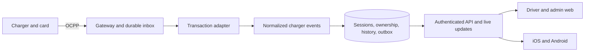

# EVCharging

An electric vehicle charging platform with a web application, backend API, and mobile app.

- `backend/` — .NET API and charging services.
- `web/` — Next.js web application.
- `mobile/` — React Native / Expo mobile application.

### Authentication limits and partial mobile loading

Authentication uses two fixed one-minute limits per API instance. Login and
registration share 15 attempts per normalized email, across web/native clients
and IP addresses. Password changes use a separate quota for the authenticated
account. The connection-IP ceiling is 300 requests, allowing independent users
behind the web server's shared egress IP. Configure these with
`EVCHARGING_AuthLimits__AccountAttemptsPerMinute` (1–100) and
`EVCHARGING_AuthLimits__IpRequestsPerMinute` (at least the account limit, up to
10,000); see `backend/.env.example`. Invalid settings fail startup.

Caller-supplied `Forwarded` and `X-Forwarded-For` headers are not trusted.
Rejected requests receive HTTP 429, `rate_limited`, a trace ID and `Retry-After`.
Logout remains available to revoke a session even after a quota is exhausted.
Counters are in memory and reset on restart; multiple API replicas have separate
quotas. A shared limiter would be needed to enforce one deployment-wide quota.

After validating the signed-in driver, mobile loads stations,
notifications and charging sessions independently. History has its own paged
loader while its screen is open. A slow or failed section
does not hold up ready sections. A failed refresh retains that account's last
data with a warning/retry; initial failure does not appear as an empty list.
Stale station data is marked, and stale charging sessions cannot produce an
active-session shortcut. Logout/account changes clear the in-memory cache;
cancelled or previous-account responses cannot replace current data.

Web uses Next.js 15.5.28 with sharp 0.35.5 for the
[October security release](https://nextjs.org/blog/nextjs-security-update-october-14-2026).
The scoped `next.postcss` override selects PostCSS 8.5.30, with patched nanoid
and source-map-js in the lockfile, including the
[PostCSS source-map fix](https://github.com/postcss/postcss/security/advisories/GHSA-fxqj-rqcc-2cmp).
Keep the override until Next's dependency no longer needs it, and rerun
`npm audit`, the web tests, typecheck and production build when updating it.

### Preview on a physical phone

The project now uses Expo SDK 57, matching the reported iPhone's Expo Go version.
The user confirmed that it opens on that iPhone. Full TypeScript, 115 local tests
and Hermes exports for iOS/Android pass on SDK 57. Exports are JavaScript/native
bytecode bundles, not signed APK/IPA files or complete physical-device tests.

From `mobile/`, run `npm run upgrade:expo-go` in a terminal with npm access. This
targets SDK 57 explicitly, upgrades through 55 and 56, checks dependency versions,
runs TypeScript and mobile tests after each step, then exports iOS and Android.
It backs up the dependency files under the ignored `.local/` directory, first
finishes alignment/checks for an interrupted SDK, and stops at the first failure.
The date picker plugin is explicitly registered in the dynamic Expo config.
The TypeScript config includes Node types for the build configuration; native
sources use the current React Native style API. Compiler temporary files stay
under `.local/mobile-build-tmp` to avoid Windows temporary-directory write errors.
`npm run upgrade:expo-go -- --plan` only prints the steps.
A failed migration may leave dependency changes that need inspection. The
current checkout has already completed the migration; it need not be repeated.

Set `EXPO_PUBLIC_API_BASE_URL` to an API the phone can reach before running
`npm run upgrade:expo-go -- --start` to open the tunnel only after the whole
upgrade and its checks succeed. Alternatively, after a successful upgrade run
`npm run start:tunnel`. This explicitly selects Expo Go
and clears Metro's cache. The required ngrok package is a local development
dependency. Keep the terminal running while using the QR shown by Expo. The
tunnel serves Metro; it does not expose the API automatically. Expo Go is a UI
preview, not verification of push delivery or a signed app build.

### Android APK for a colleague

APK delivery is deferred while physical testing continues through Expo Go on iOS.
All mobile changes still apply to both iOS and Android and are checked with both
platform exports. The last EAS attempt created the project and Android keystore,
but uploading stopped because the archive staging directory was inside the source
repository (`EINVAL`). The workflow now passes the system temporary directory
only to EAS and keeps compiler temporary files inside the project. Set
`EVCHARGING_EAS_TEMP_DIR` to an existing external directory if the system temp
location is unsuitable. It resolves junctions/symlinks and rejects paths inside
the repository before any build/install/write. The cloud build has not been
rerun; no signed APK is claimed.

The existing workflow, retained for later use, is run from `mobile/`:

```powershell
npm.cmd run build:apk
```

The command checks TypeScript/tests, installs EAS CLI inside the ignored
`.local/mobile-tools` folder if missing, and creates or links the `evcharging`
project under the selected Expo account. Sign in if prompted, choose the intended
account if several are available, and allow EAS to generate the Android keystore
when asked. No global installation is required.

Initialization uses a small static configuration under `.local/` because EAS
cannot automatically rewrite the app's dynamic configuration. The actual ID
returned by EAS is saved in `mobile/config/eas-project.json`; retain this public
project binding in version control. Subsequent runs reuse it. A conflicting
environment ID or unexpected project slug stops the workflow.

The `preview-ui` profile builds an internal, signed APK against the existing
demo API. It disables push registration/listeners and explains the unavailable
push switch in Settings, without changing the account's saved preference. The
regular `preview` and `production` profiles retain their Firebase/push setup.
This UI build does not validate real-charger behavior or store readiness.

After the Android export check, EAS uploads the required mobile/shared source
and builds the APK. `.easignore` excludes local settings, dependencies, signing
files, Git history and unrelated backend/web folders. The command waits for EAS
and prints its actual installation/download link on success. Send that link or
the downloaded APK to the colleague; the installed app needs network access to
the API, but no Expo Go, Metro tunnel or running laptop. See the
[official APK installation guide](https://docs.expo.dev/build-reference/apk/).

`npm.cmd run build:apk -- --plan` prints the workflow without changes. No store
submission, commit or push is performed. Future cloud steps require a terminal
with npm/Expo connectivity and the project's signing credentials.

### Complete driver history and mobile CI

Web and iOS/Android history screens use `GET /api/v1/driver/history/search`.
Filtering and totals cover all of the authenticated driver's eligible history,
including archived stations. The server applies the test-mode visibility rule,
station, energy, currency and completion-date filters before paging. Page size
defaults to 8 (maximum 100); sorting uses completion time and ID for stable ties.
Costs remain separate for each currency. Summary, chart and list share one
repeatable-read PostgreSQL snapshot within a request.

Parameters are `period=7d|30d|6m|custom`, `from`, `until`, `stationId`,
`energy=all|small|medium|large`, `currency`, `page`, `pageSize` and optional
`bucket` (the selected chart bucket's start date). Dates are inclusive calendar
days in Europe/Tirane, including DST. Presets end at the latest completion;
custom dates can reach older history. Charts use bounded SQL aggregates, with
at most 62 buckets even for long ranges. The original `/driver/history` array
remains for older clients and the web map's explicitly labelled recent-session
preview; it is not the source of full-history totals.

Changing filters/pages cancels the old request and hides its results immediately.
A failed refresh of the same query retains its previous result with a warning
and retry. Account changes discard previous-account data. Mobile requests history
only while that screen is mounted and pauses reads in the background.

GitHub Actions now verifies mobile in a separate job: locked `npm ci`, TypeScript,
unit/component tests and Expo exports for both iOS and Android. Platform bundles
are retained for seven days. These are Hermes bundles, not signed app packages;
the workflow does not submit to stores. CI itself runs only after the workflow is
published. Production preflight still requires the configured HTTPS API, real
privacy/deletion pages, Firebase for Android push and Apple signing/APNs for iOS.

### Station map, navigation and notification dates

The mobile Stations screen opens on the embedded map, with a compact Map/List
switch and a Filters button. City, availability and charger-rating filters start
collapsed and retain applied choices when hidden. Both views use the same filters.
In List, all station details remain visible. With multiple results, action buttons
start hidden; tapping a card reveals only its Open charging / Open in Maps buttons,
and selecting another card collapses the previous one. Tapping the same card
collapses it again. With one result (including after filtering), its actions are
visible immediately. A chevron and expanded accessibility state identify the
collapsible cards; action buttons remain separate from the card's toggle target.
Tapping a marker highlights it and reveals its details below the map: status,
address, connectors, power, tariff, Open charging and Open in Maps. A single
station shows its details automatically; the user can close the card. Opening
charging enters the existing connection/session screen; it does not start energy
transfer. The map reuses the web's OpenStreetMap tiles and shared projection
math, with dragging, pinch/zoom controls, visible attribution and a list fallback
when tiles fail. Only visible tiles are requested, with an application User-Agent
and the native image cache; no map API key is required.
Map tiles remain an external network dependency; see the
[OpenStreetMap tile policy](https://operations.osmfoundation.org/policies/tiles/).

On first opening the map, `expo-location` requests foreground location permission
and takes one balanced-accuracy fix. This module is also used in published native
builds. The camera starts around the driver when the nearest charger fits; otherwise
it includes both the driver and that charger, even when the driver is abroad.
The blue dot marks the location read at opening. Permission denial, disabled location
services, errors or a 12-second fix timeout leave the station map usable.
No background location permission, continuous tracking or coordinate storage/API
upload is added. External tile requests still reveal the viewed map area to the tile
provider. The client's publication privacy disclosures must describe this behavior.
The iOS usage text and Android foreground permissions are configured explicitly;
background location/service permissions remain disabled.

Automatic focus happens once per signed-in app session. A delayed location fix
cannot move the camera after any map interaction. Returning from charging, switching
Map/List, station refreshes and filter changes preserve the chosen camera. The fit
button explicitly frames all visible stations and the opening location again.
Restarting the app or signing out clears this in-memory state.

Native panning translates a shared tile/marker layer through Animated; small moves
within the loaded tile grid do not rebuild the React tree. New visible tiles are
prepared at most once per animation frame. Page-coordinate deltas avoid a jump when
map measurement arrives late, and switching between one and two fingers rebases
from the latest camera. Pinch remains continuous and anchored under the fingers.
Cached tiles scale between integer URL levels; Android tile fade-in is disabled.
Release/cancel retains the final view and restores page scrolling. Web retains its
existing default zoom limits. These changes do not establish a measured device FPS.

Mobile markers use stronger green/blue/orange/red/purple status colors, a separate
gray unknown status, and a compact legend. Stale status remains visibly historical.
Both web and mobile keep remaining-time labels off the map to avoid overlapping
pins. Selecting a charging station shows its public remaining-time estimate in the
details card; expanded mobile list cards show it too. Web/native share forecast
expiry rules. Stale, missing or expired estimates show a waiting message, never an
invented countdown or another driver's private charging data. The connector number
and estimate source are shown; completing a charge does not guarantee a free connector.

The bottom navigation retains the same three destinations with drawn icons, a rounded
white bar and a dark green selected tab. It stays inside the safe area and the normal
layout, including when the active-charging shortcut is visible.

Validation: mobile/web TypeScript, 97 mobile tests, 37 focused web tests, native
permission introspection and Hermes exports for both platforms passed. Native APIs
are mocked in automated tests; physical Android gestures and the final location
permission flow still need device testing. iPhone screenshots were supplied during
iteration; the final visual changes still need confirmation on the phone.

Settings now contains Google Maps / Apple Maps preference, saved on this phone
using the existing storage module; Google Maps matches the web's default. The
explicit Open in Maps action uses the saved choice and exact station coordinates.
Google Maps falls back to its website if its app is unavailable.
The map and preference must still be exercised on both physical platforms.

Notifications are newest first, grouped and filterable by the Albanian calendar
day, with eight cards per page. Times use `Europe/Tirane` and the 24-hour clock,
including daylight-saving changes. Charging start timestamps also use 24 hours.

### Mobile charging progress

iOS and Android share the charging card: a green battery banner, large reported
percentage, accessible progress bar, estimated time to full, and energy/power/
cost/duration metrics. The layout wraps on narrow screens and larger text. The
current charge appears before the station specifications. Back navigation uses
a compact arrow/text control with a 44-point minimum touch height. The visual hierarchy
draws on the existing web screen and [ChargePoint's app examples](https://www.chargepoint.com/drivers/mobile).

The remaining-time calculation and explanations are shared with web. The API
already supplies profile capacity, reported battery percentage, total power and
their freshness deadlines. Missing profile capacity offers an action to open the
profile. Pauses, faults, stale data, missing readings and partial phase power do
not produce a numeric estimate. New readings update the estimate; elapsed time
alone does not invent battery progress. A completed charge keeps its last reported
percentage, without forcing 100%, and no longer shows an ETA. A disputed final
meter reading does not show a confirmed final cost.

Web and mobile keep the last valid battery percentage visible when it expires or
the charger disconnects, with a gray progress bar and an awaiting-update label.
The last session reading uses Albania's 24-hour clock; it is not presented as the
timestamp of the battery sample specifically. Current power and ETA remain
unavailable while disconnected. Session time includes pauses and disconnected
waiting until the device confirms the stop; a ticking duration does not imply
that energy is still transferring.

Return to charging appears above the mobile tabs only for the signed-in driver's
open sessions currently reported as Charging, and opens their exact connector.
It is hidden on that connector's detail screen, during pauses, disconnections,
faults or failed refreshes, and after completion. It reappears when fresh data
confirms charging again. The authenticated session list refreshes every 15 seconds
in the foreground and immediately on foreground return. When the charging screen
confirms completion on its own poll, it removes the shortcut immediately; a slower
list response cannot restore it. Account changes clear all session data.

Validation: mobile/web TypeScript, 82 mobile tests, 32 focused web charging tests,
and both Hermes exports passed. Native UI tests use simulated platform modules;
Android physical-device testing is still outstanding. No APK build, store upload,
backend migration or new package is part of this update.

### Requested iOS Live Activity (not implemented)

The requested Dynamic Island display would show an approximate remaining time
from the same validated charging estimate, with battery level in the expanded
presentation and a tap opening the correct charging connector. Unknown or stale
measurements must not produce an invented countdown. Completion must end the
activity; pauses/disconnections must remove the active charging presentation.

[Expo SDK 57 Widgets](https://docs.expo.dev/versions/v57.0.0/sdk/widgets/) supports
Live Activities, but not inside Expo Go. Testing on the iPhone through the current
EAS workflow requires a signed development build and an Apple Developer account,
which is not yet available. Reliable updates and ending while the app is in the
background also require an authenticated, per-session ActivityKit token lifecycle
and [server updates through APNs](https://developer.apple.com/documentation/ActivityKit/starting-and-updating-live-activities-with-activitykit-push-notifications).
The current foreground polling and ordinary Expo notifications do not implement
that lifecycle. No widget dependency, native extension, APNs endpoint or background
Live Activity support has been added or validated in this change. This feature
remains pending; the current iOS/Android in-app experience stays testable in Expo Go.

The project is under active development.

See [CHANGELOG.md](CHANGELOG.md) for the change history.

## Mobile scope and store readiness — 18 October 2026

Phase 1 remains monitoring, station administration, personal history, profile and
notifications. The Driver uses the Expo app or Driver web portal; Admin and
Superadmin use the responsive web workspace. Electronic payments, wallet,
subscriptions and remote start/stop are not added by this mobile refinement.

The phone station editor now opens separately from the station list, with a back
action and a warning before discarding edits. Session rows become labelled cards
on phones; filters are expandable. Web and native Driver views share guidance for
offline, unavailable, occupied and card-linked chargers. A station view does not
claim a charging session. The native charge uses its saved session tariff, and
declining push permission does not interrupt normal monitoring.

**Store submission is not ready yet.** Configure the client's actual pages in the
mobile build environment:

```text
EXPO_PUBLIC_PRIVACY_URL=
EXPO_PUBLIC_ACCOUNT_DELETION_URL=
```

Use public HTTPS pages without user identifiers, tokens or credentials. Privacy
is accessible before login and in Settings; the account-deletion entry appears in
Settings. The latter must open the actual deletion request/completion flow,
including identity verification and confirmation. A homepage, email-only support
link, or merely disabling an account is insufficient. No deletion service or
client retention policy is implemented by configuring these links. The client
must supply the pages, approved retention rules and an operational deletion
process. Production configuration rejects missing/invalid pages; internal preview
builds remain available for hardware testing. These checks validate configuration,
not the live page or the outcome of store review.

From `mobile`, run `npm run check:store:ios` and
`npm run check:store:android` before submission. Existing API HTTPS, Expo project
and Android Firebase checks also apply. The normal `check:ios` / `check:android`
commands continue to support internal preview.

Before submission, the release owner must complete:

- Client-approved privacy page and actual account/data deletion workflow, reachable
  both from the app and the Google Play listing. Declare retained data and timing.
  See [Apple account deletion](https://developer.apple.com/help/app-review/guideline-reference/5-1-1-account-deletion)
  and [Google Play account deletion](https://support.google.com/googleplay/android-developer/answer/13327111?hl=en).
- App Store App Privacy / Google Play Data safety disclosures matching the actual
  build, backend and SDKs: account/contact/vehicle information, charging history,
  push tokens and diagnostics as applicable. Verify the final native permissions
  and SDK privacy manifests; configuration source alone does not prove the binary.
- A working reviewer Driver account, reachable backend and clear instructions for
  the card/charger flow. For hardware-dependent review prepare a video showing
  the app on a physical device interacting with the charger; do not silently turn
  on global production TestMode to imitate real charging. See
  [Apple review information](https://developer.apple.com/help/app-review/before-submitting-for-review/complete-review).
- Signed iOS/Android builds, store identifiers and credentials, current platform
  submission requirements, and real-device tests: registration/login/logout,
  large text/VoiceOver/TalkBack, keyboard and Back, connection loss/recovery,
  notifications allowed/declined, own-versus-other-user data, and charging history.
  Test iPad too while `supportsTablet` remains enabled.
- Verify the newly implemented mobile map on physical devices: filtering,
  dragging/pinching, station taps, saved Google/Apple preference and unavailable
  external apps/tiles. QR scanning, payments and remote start remain outside the
  implemented native features.

## QR, card and ownership boundary

The implemented physical flow is:

```text
Registered card -> charger sends idTag -> backend matches assigned Driver
               -> StartTransaction creates the owned session
               -> MeterValues/StopTransaction update that session and its history
Signed-in Driver -> authenticated API/live updates -> own session only
```

The current station configuration supports **one assigned Driver/card per physical
charger**, plus an allowed-card list whose charges have no personal Driver owner.
It is not a general multi-customer RFID registry. Do not change assignments during
a charge; past history retains its original owner. Confirm this operational model
with the client before treating it as a shared public charging network.
The decision about a different physical-charger ownership model is deferred;
the October 21 review retains this behavior until that model is defined.

A QR printed on a charger should identify only the station and connector. The
authenticated app already identifies the person; scanning a public label must not
grant ownership of an existing or subsequent charge. QR resolution/scanning and
QR-initiated charging are not implemented in this refinement. If later required,
their server-verified authorization must be designed from the actual charger
capabilities, without accepting an arbitrary user ID from a QR or HTTP body.

In OCPP 1.6, card authorization and transaction identity are separate from a
vendor's prepaid balance or payment system. An `idTag` alone does not establish a
balance or prove a payment. Verify the actual device/card provider instead of
assuming money is stored on the card. The OCA's
[OCPP 1.6 test cases](https://openchargealliance.org/wp-content/uploads/2025/09/CompliancyTestTool-TestCaseDocument.pdf)
cover authorization and transaction behavior; the implementation here calculates
cost but does not collect payment.

During the physical trial record the exact card `idTag`, station identity and
connector number. Check Authorize, StartTransaction, meter values and stop; verify
that a second Driver sees none of the first Driver's readings. Also check an
unassigned/unknown card, two connectors, reconnection and app background/foreground.
Use internal preview while these observations and store prerequisites are pending.

## Open-session recovery and architecture review — 18 October 2026

The app's `driver_already_connected` response means a **manual demo association**
is still Waiting or Linked at another connector. Opening a station is read-only;
the demo Connect action creates the waiting request. Waiting requests expire after
30 minutes and can be cancelled. Once linked to a started session, that timeout
no longer closes the session. A phone going into the background, a closed browser
simulator, a charger disconnect or a pause is not evidence of a confirmed stop.

The station response now includes an optional, owner-only `blockingConnection`.
Web, iOS and Android name its station/connector and offer **Open waiting request**
or **Open existing session**, instead of inviting another blocked connection.
The former leads to the existing Cancel waiting action. The latter opens the
session without stopping it or changing its owner. A conflict discovered between
polls triggers a fresh read. Ownership changes and completion at the previous
station refresh the currently viewed station without merging the other station's
session into it. Expired waiting requests and confirmed completed
sessions no longer block the action. The API field is additive; deploy the backend
with the web changes to make this recovery available to a running phone preview.

### Structure and authoritative state

| Area | Responsibility |
| --- | --- |
| `backend/src/EVCharging.Api` | Authenticated HTTP/live endpoints and WebSocket admission. |
| `backend/src/EVCharging.Infrastructure/Charging/Ocpp` | OCPP parsing, durable message inbox, replay, device transactions and protocol adapter. |
| `backend/src/EVCharging.Application` and `Domain` | Protocol-independent contracts and business entities; no EF, PostgreSQL or WebSocket dependency. |
| `backend/src/EVCharging.Infrastructure/Charging` | Normalized sessions, ownership, tariffs, history, projections and notifications; participates in the adapter's transaction. |
| `contracts`, `shared`, `web`, `mobile` | Shared payloads/guidance, authenticated views and status presentation; the shared native screen serves both iOS and Android. |



PostgreSQL locks serialize device/account mutations and unique indexes protect
active connectors and manual claims. Successful OCPP handling commits before
replying. A session snapshots its tariff at the start; invalid final meter
regressions leave the final amount unconfirmed. Transport online/offline state,
connector status, transaction lifecycle and account association are separate.
The map or a hidden mobile shortcut never closes the underlying transaction.

| Evidence | Session/claim outcome |
| --- | --- |
| Demo connection requested, no start received | Waiting; cancellable, expires after 30 minutes. |
| Accepted StartTransaction | Linked to the confirmed session; cannot be cancelled as a waiting request. |
| Pause, disconnect, stale readings, or Available status alone | Session remains open; power/ETA must not imply fresh charging. |
| Confirmed StopTransaction | Session and claim complete; another manual connection is permitted. |
| Retried confirmed message | Recover the original result; no duplicate session/history. |

### Corrections and remaining recovery limits

- A successful retained StartTransaction now replays its original response after
  a reconnect even beyond 24 hours, provided its message ID, payload and device
  match and its transaction references the inbox entry. Previously the one-day
  replay cutoff could strand a charger after a lost acknowledgement. Rejected
  attempts do not gain permanent replay and changed payloads do not inherit success.
- The browser simulator freezes its StopTransaction ID, final register, timestamp
  and reason before sending final telemetry. Rejected or unanswered final
  MeterValues/estimate/Finishing reports no longer prevent attempting the stop.
  Reconnect and retry use the original stop frame; an unresolved stop prevents
  resume or another start. This also applies to the existing demo recovery action.
- Simulator state and its pending stop remain in memory. Refreshing/closing the
  page loses that local state and does not stop the server's transaction. Keep the
  page open during a test. To recover a known demo charge after reload, select its
  station, connect the simulator and press Start charging to check the server.
  When the existing transaction appears, verify the **Final test meter register**
  and use **Finish existing transaction**. This is a demo test tool, not physical
  charger recovery or a source of billable final readings.

For real equipment, use the device's stop/card flow and verify that its queued
StopTransaction reaches the backend after reconnecting. The
[OCA OCPP 1.6 test cases](https://openchargealliance.org/wp-content/uploads/2026/03/CompliancyTestTool-TestCaseDocument.pdf)
cover offline stop/queued transactions (2.15.5–2.15.6) and configurations where
unplugging at the vehicle does not itself end a transaction (2.3.5). The actual
charger's behavior must be observed. Do not close transactions by timeout, delete
claims or manufacture a meter reading to remove a warning.

If the physical device permanently loses the stop, the current implementation
can leave that connector blocked for another start and its final history/cost
unresolved. An audited operator reconciliation procedure with actual device/meter
evidence is still a production requirement; no such endpoint or remote-stop
workflow has been added. Separately, the current one-assigned-Driver/card-per-device
model described above must be confirmed with the client before multi-customer use.

Before production, record acceptance evidence for lost start/stop acknowledgements,
long reconnects, API and charger restart, offline message delivery, two connectors,
PostgreSQL concurrency, invalid final readings and owner-only visibility. Include
the case where the physical stop can never be recovered and define who resolves
it. Local tests and simulator success do not certify the hardware or remove these
release prerequisites. Existing live records were not edited by this change.

Validation of this revision: 125 backend tests passed with the existing local
in-process runner: 44 OCPP/API tests including all four new recovery regressions,
and 81 architecture, operations and reconnect cases. The serial .NET
build passed with zero warnings/errors; the standard VSTest process stalled after
discovery, so it supplied no test results. All 100 mobile and 195 web Node tests,
both TypeScript checks and both iOS/Android Hermes exports passed. Native modules
and simulator sockets are mocked in unit tests; PostgreSQL and physical-device
acceptance remain pending. The web suite includes two regressions for live
cross-station blocker reconciliation. No schema migration is required.

## Production presentation and test mode

Set **one backend environment variable**, then restart the API:

```text
EVCHARGING_Features__TestMode=false
```

The default is `false`, including when the variable is absent. Set it to `true`
on a test deployment to enable the existing demonstration tools. This switch is
independent of `DOTNET_ENVIRONMENT`; changing it requires an API restart, not a
database migration. Reload the web application after changing modes. The web
reads the authenticated `/api/v1/features` endpoint and defaults to OFF if that
lookup fails. Mobile uses the same server permissions and filtered responses.

| Behavior | OFF (default) | ON (testing) |
| --- | --- | --- |
| Physical OCPP connection, heartbeat and meter processing | Enabled | Enabled |
| Card authorization and real session ownership/history | Enabled | Enabled |
| Simulator connections, stations and direct simulator page | Disabled/hidden | Enabled |
| Demo map entries, history, sessions and station analytics | Hidden | Included |
| Driver protocol diagnostics, raw samples and diagnostic downloads | Hidden in HTTP, live events and UI | Available to the authorized session owner/demo recipient |
| Physical device assignment without a card | Rejected; old no-card assignments are inactive for new charges | Available for demonstrations |
| Superadmin operational logs and normal station management | Available, with role checks | Available, with the same role checks |

Stored demo data is retained, so enabling test mode makes it visible again. No
physical history or existing session ownership is deleted. With testing OFF,
new physical charges at a mapped station require a matching assigned card or an explicitly allowed
card; an allowed card without an assigned Driver does not expose its session to
another account. Configure the Driver's card in the station's device settings
before testing the normal user experience.

The master switch overrides the old `EVCHARGING_Ocpp__SimulatorEnabled` and
`EVCHARGING_Ocpp__AllowAnonymousSimulators` settings when OFF. With the master ON,
both default to true for the built-in browser simulator. Either subordinate
option can still be set false; authenticated external simulators then require
`EVCHARGING_Ocpp__SimulatorPassword` (12–128 characters). A browser simulator
cannot supply that Basic credential. Use test mode only for deliberate testing.

`--seed-demo` additionally requires the master switch and a Development/Testing
host. In the Render entrypoint, `EVCHARGING_SEED_DEMO_ON_START=true` is ignored
while the master is OFF, even if left over from an earlier demo. When the master
is ON and neither host environment is specified, the entrypoint selects
Development. Existing explicitly configured host environments remain authoritative.
An explicit Production host can run test tools with the flag ON, but cannot seed
demo accounts. Production database and HTTPS CORS checks remain enforced.

This switch prepares the normal product experience; it does not implement QR or
payment-provider verification, change physical device admission/credentials,
or certify unattended hardware reconnection. Those are separate production
requirements. Operational logs remain available to Superadmin to investigate them.

## Three-route charger test — 17 October 2026

Deploy this backend Docker image and the web once before the test. All three
approaches then use that same code, API, database, card configuration and charger
identity. Switching requires environment changes/redeploys and updating the
charger's URL, not another code edit. An API deploy interrupts existing sockets.
Keep one API instance, upgrade its compute plan before the test, and retain the
previous working connector until a new route has been verified.

The **backend** environment variable `EVCHARGING_Tunnel__Mode` selects where the
connector runs. Its default is `direct`; a misspelled mode fails configuration
validation. It is independent of `EVCHARGING_Features__TestMode`. Direct OCPP
access to the API remains available in every mode for rollback.

| Order | Backend mode | Physical charger URL | Extra connector service |
| --- | --- | --- | --- |
| 1 | `direct` | `wss://vcharging-api-demo.onrender.com/ws/cs/NKR2023072805` | None |
| 2 | `embedded` | `wss://<embedded-host-from-API-logs>.trycloudflare.com/ws/cs/NKR2023072805` | None; API manages cloudflared |
| 3, only if 1 and 2 fail | `external` | `wss://<external-host-from-worker-logs>.trycloudflare.com/ws/cs/NKR2023072805` | Paid Background Worker, created only for this fallback |

Both Quick Tunnel variants use the pinned `cloudflared:2026.9.0`, HTTP/2 to
Cloudflare, the public API's HTTPS origin, matching Host/SNI, verified TLS and
HTTP/1.1 to origin. The embedded route deliberately forwards to the same public
API origin as the separate connector, rather than introducing a fourth,
loopback-only topology during the comparison.

### Common preparation

1. In the existing API service's **Environment**, set:

   ```text
   EVCHARGING_Tunnel__Mode=direct
   EVCHARGING_Tunnel__Origin=https://vcharging-api-demo.onrender.com
   EVCHARGING_Features__TestMode=true
   EVCHARGING_SEED_DEMO_ON_START=false
   ```

   Origin is required only for `embedded`; when absent on Render it defaults to
   `RENDER_EXTERNAL_URL`. Keep the existing database, credentials, allowed hosts
   and HTTPS CORS settings. No migration, bootstrap or demo re-seed is required
   for route switching. If legacy `Ocpp:SimulatorEnabled` or
   `Ocpp:AllowAnonymousSimulators` variables are explicitly false, set them true
   for the built-in simulator during this test.
2. Deploy the API and web from this same code revision. Use **Environment > Save
   only**, then **Manual Deploy > Deploy latest commit** if selecting the new
   revision manually. Once only the environment changes, **Save and deploy** is
   sufficient. Set the API health check path to `/health/ready` if not already set.
3. Use the read-only PowerShell helper to generate matching URLs and environment
   values. It does not access the network or change a service or device:

   ```powershell
   .\scripts\ocpp-route-plan.ps1 -Mode direct | Format-List
   ```

### Trial 1 — direct Render API

Keep `EVCHARGING_Tunnel__Mode=direct`. Set the **web** environment variable
explicitly and redeploy the web:

```text
EVCHARGING_SIMULATOR_WS_BASE_URL=wss://vcharging-api-demo.onrender.com/ws/cs/
```

The simulator now defaults to the configured API origin when this web variable
is absent. Older web builds special-cased the demo API to a legacy Cloudflare
Worker; changing only the API's `Tunnel__Mode` did not change that browser URL.
An existing explicit web value still takes precedence and must match the route
being tested. `ConnectionAttempt` in new simulator logs records the validated
endpoint and `ocpp1.6` protocol before the handshake. Browser WebSocket errors do
not reveal its HTTP rejection status; use the API's OCPP logs to distinguish
admission failure (401), an existing connection (409), or other causes. No live
connection is established merely by the local tests or this configuration fix.

Configure the physical URL shown in row 1. If the charger appends its identity
itself, enter only `wss://vcharging-api-demo.onrender.com/ws/cs`. Probe readiness
and OCPP as described under "Checks for every route" below. If the physical
charger passes the entire flow, stop the comparison here.

### Trial 2 — Quick Tunnel inside the existing API

Set **backend** `EVCHARGING_Tunnel__Mode=embedded` and **Save and deploy**. The
API starts cloudflared after the HTTP host starts. Its stdout/stderr go to the
API service's **Render Logs**. Search for `OCPP embedded Quick Tunnel` to find
the new HTTPS hostname, then generate the matching configuration:

```powershell
.\scripts\ocpp-route-plan.ps1 -Mode embedded -TunnelBaseUrl "https://<embedded-host>.trycloudflare.com" | Format-List
```

Set the generated **web** variable, redeploy the web, and update the physical
charger URL. Keep the normal web application's API base pointed at Render;
only the simulator WebSocket base uses the tunnel. This variant uses the
existing API compute plan and needs neither a domain nor another paid worker.
The API and connector share that instance's CPU/RAM; monitor memory during the
physical test. Use a paid, always-on API instance for these comparisons.

The .NET host manages the child process and stops it on shutdown. A connector
exit or startup failure is logged and retried after five seconds while the API
continues serving direct requests. Each connector restart can create a **new
hostname**; update both charger and simulator settings after that happens. An
API deploy also restarts the embedded connector. Disabling TestMode does not
stop the tunnel or physical charging. Set mode back to `direct` and redeploy
to stop the embedded connector.

### Trial 3 — separate Quick Tunnel worker, last fallback

Set the **backend** mode to `external` and redeploy so it stops any embedded
connector. This mode does not create, pay for, or stop an external service.
Only if the first two physical trials fail, create the separate worker:

| Render field | Value |
| --- | --- |
| Service type / source | Background Worker / Existing Image |
| Image | `docker.io/cloudflare/cloudflared:2026.9.0` |
| Name | `evcharging-ocpp-quick-tunnel` |
| Region / instances | Frankfurt / 1 |
| Compute | Smallest paid instance; review the displayed price |
| Docker Command | `tunnel --protocol http2 --url https://vcharging-api-demo.onrender.com --http-host-header vcharging-api-demo.onrender.com --origin-server-name vcharging-api-demo.onrender.com --no-tls-verify=false --http2-origin=false --grace-period 10s` |

No connector token, Cloudflare account or domain is needed for this Quick
Tunnel. Alternatively apply [render.quick.yaml](tools/cloudflare-tunnel/render.quick.yaml)
as a **separate** Blueprint, using that exact path, only when ready for the paid
fallback. Use one creation method. Do not apply the named-tunnel `render.yaml`
for this trial, and do not create a second API or database. The image supplies
the `cloudflared --no-autoupdate` entrypoint; Docker Command contains its arguments.

Read the random HTTPS hostname from this **worker's Render Logs**, then run:

```powershell
.\scripts\ocpp-route-plan.ps1 -Mode external -TunnelBaseUrl "https://<external-host>.trycloudflare.com" | Format-List
```

Update the charger and the web's simulator base using that output. Worker
restarts change this URL too. Reverting the backend mode alone does **not**
stop the worker or its bill; remove the separate worker after a failed trial.
Deleting this disposable connector does not remove the API or database.

### Checks for every route

1. Open that route's `/health/ready` and confirm HTTP 200 with `{"status":"ready"}`.
   This tests HTTP only, not physical charger compatibility.
2. Run the OCPP probe with a separate setup identity:

   ```powershell
   . .\scripts\charger-test-tools.ps1
   Test-PublicOcpp -BaseUrl "https://<host-of-current-trial>"
   ```

   It throws on handshake/subprotocol/BootNotification failure. `VoidTaskResult`
   output alone can occur on success. A simulator passing does not establish
   that the physical device passes.
3. With the physical charger idle, change its URL, note the exact test time and
   allow at least five minutes for the observed hardware reconnect delay. In
   Superadmin logs confirm identity `NKR2023072805`, accepted BootNotification
   and continuing Heartbeat replies. Record the actual HTTP status/CF-Ray when
   a handshake fails; do not treat a missing Worker event as a diagnosis.
4. Test a brief idle network interruption and automatic recovery. Then test an
   actual authorized charging session, MeterValues, StopTransaction and saved
   history. Register the correct card first: a StartTransaction `SecurityError`
   is separate from successful WebSocket connectivity. Do not reuse the physical
   identity in a simulator/probe because it can replace its connection.
5. On the successful route, set **backend** `EVCHARGING_Features__TestMode=false`,
   redeploy/reload, and repeat the authorized physical flow. The simulator and
   Driver diagnostics should be hidden. Keep the route mode unchanged.

Quick Tunnels have temporary hostnames and no uptime guarantee. These three
trials are prepared alternatives, not proof that any untested hardware route
will succeed. The named tunnel below is a later option for a stable hostname.

## Persistent OCPP tunnel

The optional [Render Blueprint](tools/cloudflare-tunnel/render.yaml) runs
`cloudflared` as a separate Background Worker. It replaces the computer running
the temporary tunnel while retaining the existing Render API and database:

```text
Charger --WSS--> Cloudflare Tunnel --> cloudflared on Render --HTTPS--> Render API
```

This uses a named, remotely managed Cloudflare Tunnel. It does not execute the
JavaScript proxy in `tools/cloudflare-ocpp`. The current Quick Tunnel can remain
available during setup. A new hostname and connector location still require a
physical charger test, including automatic reconnection; success through the
temporary tunnel does not establish the cause of earlier HTTP 403 responses.

### Requirements

- A domain you control, active in Cloudflare DNS. `ocpp.example.com` below is a
  placeholder. A `workers.dev` address cannot serve as this domain.
- A named tunnel in Cloudflare and its connector token.
- A paid Render Background Worker. Review the price shown by Render before
  creating it; domain registration and API/database hosting are separate costs.
  The optional Blueprint selects one `0.5c-512mb` instance in Frankfurt and does
  not upgrade the existing API or database. Production availability also requires
  an API that stays running and a durable database.

Cloudflare documents [named tunnels](https://developers.cloudflare.com/tunnel/get-started/)
and the temporary hostname/lifetime limits of
[Quick Tunnels](https://developers.cloudflare.com/tunnel/get-started/quick-tunnels/).
Render documents [Background Workers](https://render.com/docs/background-workers)
and [image deployments](https://render.com/docs/deploying-an-image).

### 1. Create the named tunnel and connector

In Cloudflare, open **Networking > Tunnels**, create a tunnel named
`evcharging-ocpp`, and select the Docker installation instructions. Copy only
the connector token into Render's secret environment variable `TUNNEL_TOKEN`.
Keep it out of source files, command overrides, screenshots, and chat.

In Render, choose **New > Background Worker > Existing Image**:

| Setting | Value |
| --- | --- |
| Name | `evcharging-ocpp-tunnel` |
| Image | `docker.io/cloudflare/cloudflared:2026.9.0` |
| Region | Frankfurt |
| Instance count | 1 |
| Docker Command | `tunnel --protocol http2 --grace-period 30s run` |
| Environment | `TUNNEL_TOKEN` = the connector token |
| Maximum shutdown delay | 60 seconds |

Alternatively, apply `tools/cloudflare-tunnel/render.yaml` as a separate
Blueprint using that file's path. Use one creation method to avoid duplicate
workers. The image supplies the `cloudflared --no-autoupdate` entrypoint; the
command above supplies its arguments. Version `2026.9.0` matches the successful temporary
connector test. The official
[release](https://github.com/cloudflare/cloudflared/releases/tag/2026.9.0) is pinned
so a restart does not silently select a new version.

The worker initiates outbound connections to Cloudflare using HTTP/2; it needs
outbound TCP port 7844. It does not need an incoming port or a Render public URL.
Confirm `Registered tunnel connection` in Render logs and `Healthy` in
Cloudflare before continuing. The
[run parameters](https://developers.cloudflare.com/tunnel/reference/run-parameters/)
document token environment variables, transport selection, and shutdown handling.

### 2. Publish the OCPP hostname

On the tunnel's **Routes** page, add a **Published application** route using a
subdomain of your domain, for example `ocpp.example.com`:

| Setting | Value |
| --- | --- |
| Hostname | Your actual OCPP subdomain |
| Path | `^/(health/ready\|ws/cs/[A-Za-z0-9_-]{1,40}/?)$` |
| Service | `https://vcharging-api-demo.onrender.com` |
| HTTP Host Header | `vcharging-api-demo.onrender.com` |
| Origin Server Name | `vcharging-api-demo.onrender.com` |
| Disable TLS certificate verification / No TLS Verify | Off |
| Use HTTP/2 to origin | Off |

The path expression contains a literal `|` between `health/ready` and `ws/cs`.
These origin settings preserve the working comparison's Host, TLS verification,
and HTTP/1.1 WebSocket upgrade to Render. The public hostname belongs to the
tunnel; do not add it as a custom domain of the Render API. The Cloudflare
dashboard creates the tunnel's DNS route. If configuring DNS separately, its
proxied CNAME target is `<TUNNEL_ID>.cfargotunnel.com`.

[ingress.example.json](tools/cloudflare-tunnel/ingress.example.json) is the
equivalent Cloudflare configuration API body, with a final 404 catch-all. Replace
its example hostname before use and apply it only to this new tunnel. Render
does not load this file: remotely managed tunnel routes are configured in
Cloudflare. Keep interactive Access login and browser challenges off this OCPP
hostname; admission and transaction authorization remain in the API.
See Cloudflare's
[origin settings](https://developers.cloudflare.com/tunnel/reference/origin-parameters/).

### 3. Verify and switch the charger

1. Request `https://<your-ocpp-hostname>/health/ready` and confirm HTTP 200 with
   `{"status":"ready"}`. This checks HTTP readiness only.
2. Run the existing PowerShell test against the new hostname:

   ```powershell
   . .\scripts\charger-test-tools.ps1
   Test-PublicOcpp -BaseUrl "https://<your-ocpp-hostname>"
   ```

   The helper throws if the connection, `ocpp1.6` negotiation, or accepted
   BootNotification fails. It may print `VoidTaskResult` on success.
3. Configure the physical charger with
   `wss://<your-ocpp-hostname>/ws/cs/<charge-point-id>`. If its configuration
   appends the ID automatically, enter only the base ending in `/ws/cs`.
4. Confirm the physical ID, accepted BootNotification, status messages, and
   continuing Heartbeat replies in the application logs. Test a brief network
   interruption and recovery while the charger is idle, then verify an actual
   authorized charging session separately. Connector or API restarts can close
   existing sockets even though the public hostname stays the same.
5. Once the new route passes these checks, stop the temporary connector. To make
   the built-in simulator use the same new route, set the web service's
   `EVCHARGING_SIMULATOR_WS_BASE_URL` to `wss://<your-ocpp-hostname>/ws/cs` and
   redeploy the web service. This is a later cutover step, not part of the worker
   Blueprint.

Until the new hostname is verified, the running Quick Tunnel is the fallback.
If that temporary process is stopped, its URL cannot be assumed reusable.
