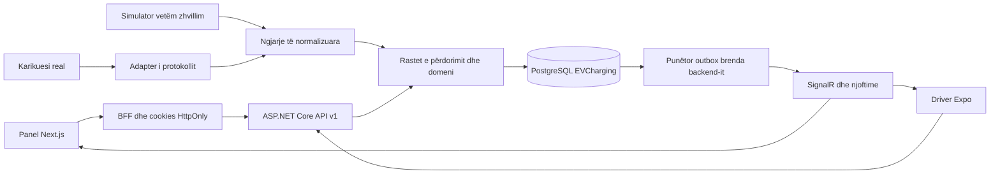

# Arkitektura e propozuar

Rekomandohet një monolit modular .NET me një databazë PostgreSQL të pavarur, një panel Next.js dhe një aplikacion Expo për Drejtuesin. Ky dokument përshkruan arkitekturën e synuar. Baza .NET/Next dhe identiteti janë implementuar pjesërisht; gjendja konkrete dhe verifikimet janë te [implementation-status.md](implementation-status.md). Mobile është shtyrë për t’i dhënë përparësi web-it.

## Kufijtë dhe rrjedha



Nuk planifikohen microservices, Redis, Kafka, Elasticsearch ose Kubernetes. Inbox/outbox janë tabela të vogla në të njëjtën databazë dhe një punëtor i backend-it. Ato mbështesin ruajtjen e ngjarjeve dhe përditësimet pas commit-it.

| Modul | Përgjegjësia | Kufiri |
|---|---|---|
| Identity & Access | Autentikim, tre role, aktivizim/çaktivizim, caktime | API dhe SignalR zbatojnë politikat; UI nuk vendos aksesin |
| Driver Profile & Settings | Profili, automjeti, cilësimet e dakordësuara | Vetëm të dhënat e llogarisë përkatëse |
| Locations | Vendndodhje, adresë, koordinata, arkivim | Shkrim nga Superadmin |
| Charging Points | Identiteti, lidhësi, fuqia, gjendja, arkivimi | Admin sipas caktimeve, Superadmin global |
| Pricing | Çmimi aktual dhe revisionet e pandryshueshme | Jep revisionin e vlefshëm për nisjen e sesionit |
| Charging Sessions | Lidhja, nisja, matjet, përfundimi, kostoja | Burim autoritativ për klientët |
| Charger Integration | Verifikim/përkthim i eventeve të pajisjes | Domain nuk njeh OCPP ose prodhuesin |
| Notifications | Vetëm llojet e specifikuara, marrës të autorizuar | Push në telefon sq/en i konfirmuar; email/SMS jashtë këtij hapi |
| Audit | Ndryshime administrative me actor/role/before/after | Transaksion i përbashkët me veprimin |

Dashboard është një grup leximesh të agreguara mbi këto module, pa databazë ose mikroshërbim më vete. Përdor SELECT/COUNT/SUM të kufizuara sipas aksesit, lista të paginuara dhe indeksim. Nuk shkarkon të gjitha sesionet në browser për të llogaritur treguesit.

## Struktura e ardhshme

Pema më poshtë mbetet modeli i synuar për të gjitha modulet. Struktura reale e hapit të parë gjendet në backend/src, web/src dhe mobile/src:

```text
EVCharging/
  backend/
    EVCharging.slnx
    Directory.Packages.props
    src/
      EVCharging.Domain/            # entitete, gjendje, invarianta
      EVCharging.Application/       # use cases sipas moduleve, ports, policies
      EVCharging.Infrastructure/    # EF, mappings, migrations, adapters, worker
      EVCharging.Api/               # routes/controllers, DTO mapping, hub, startup
    tests/
      EVCharging.Domain.Tests/
      EVCharging.Application.Tests/
      EVCharging.Integration.Tests/
    tools/EVCharging.Simulator/     # vetëm zhvillim; jashtë image-it production
  web/
    src/app/                       # login, admin, superadmin, BFF
    src/features/                  # ekranet sipas aftësive të produktit
    src/components/ui/             # komponentë dhe tokens
    src/lib/                       # konfigurim, API, sesion, realtime
  mobile/
    app/                           # navigim Expo
    src/features/                  # map, sessions, profile, settings
    src/components/map/            # kontrata, Android, iOS
    src/lib/                       # API, SecureStore, lifecycle, realtime
  contracts/                       # schema OpenAPI dhe klientë TS të gjeneruar
  docs/
```

Varësitë .NET: Domain nuk referon projekte të tjera; Application referon Domain; Infrastructure implementon kontratat e Application; Api kompozon Application/Infrastructure. EF mappings mbeten në Infrastructure. Nuk futet generic repository mbi EF. Application i orkestron transaksionet përmes kontratës së persistence; rregullat e biznesit nuk jetojnë në controller/hub.

Një solution dhe një proces backend mjaftojnë. Organizimi sipas moduleve brenda projekteve shmang shërbime shumë të mëdha. Web dhe mobile konsumojnë DTO, jo entitete EF apo kod nga HOUSS.

## Kontratat dhe gjendja e klientit

API `/api/v1` ka DTO të veçanta, gabime të qëndrueshme dhe OpenAPI. Klientët TypeScript gjenerohen nga i njëjti specifikim kur API-ja të ekzistojë. Kontrata e gjendjeve ka vlera semantike, versionim dhe fallback për vlerë të panjohur. Nuk krijohet monorepo framework vetëm për ndarjen e disa tipeve.

Gjendja server ruhet në query cache; gjendja UI, si filtra/pika e zgjedhur/kamera, mbahet veç. Kostoja, energjia finale dhe autorizimi vijnë nga serveri. Klienti mund të animojë kohëzgjatjen provizore nga koha e serverit, por pas rifreskimit përdor vlerat autoritative.

Ngjarjet SignalR përditësojnë/invalidojnë cache; pas lidhjes ose rikthimit merret snapshot REST dhe aplikohet kontrolli i versionit. Kjo mbulon boshllëqet e komunikimit pa trajtuar WebSocket si histori të qëndrueshme.

## Siguria dhe konfigurimi

Detajet janë në [autorizim/API](security-and-api.md). Password hashing me mekanizmat .NET Identity; role fikse, kontroll i caktimeve në server, në hapin aktual token opaque i hash-uar, i revokueshëm dhe me skadim absolut. Rotacioni refresh mbetet për më vonë. Web përdor BFF/cookies; mobile SecureStore. Nuk ka credential ose identitet HOUSS në projektin e ri.

| Mjedisi | Kufiri i propozuar |
|---|---|
| Development | DB dhe secrets lokalë të EVCharging; simulator i aktivizuar shprehimisht |
| Test | DB e përkohshme/izoluar; adapter fixtures; asnjë host prodhimi |
| Staging | DB, issuer/audience, keys dhe origins të veçanta; pa seed aksidental |
| Production | HTTPS, secrets të menaxhuara, simulator i përjashtuar, migrime të kontrolluara |

Konfigurime të parashikuara: `EVCHARGING_ConnectionStrings__Default`, `EVCHARGING_Auth__Issuer`, `EVCHARGING_Auth__Audience`, `EVCHARGING_Auth__SigningKey`, `EVCHARGING_Cors__AllowedOrigins__0`, `EVCHARGING_ChargerIntegration__Provider`. Emrat janë propozime, jo konfigurim që mund të ekzekutohet sot.

Web ka `EVCHARGING_API_BASE_URL` vetëm në server dhe origin publik të veçantë për SignalR. Mobile ka `EXPO_PUBLIC_API_BASE_URL`; çdo `PUBLIC` është publik dhe nuk mban sekrete. Konfigurimi i hartave ndahet sipas platformës dhe çelësat publikë kufizohen sipas aplikacionit/domain-it. Portet lokale propozohen 5201 API, 3100 web, 5440 PostgreSQL; do të kontrollohen për konflikt përpara përdorimit.

Startup/build verifikon vlerat e detyrueshme; production ndalon placeholder, wildcard CORS, URL lokale dhe simulator. Development nuk përdor fallback në live. Migrimet janë të versionuara; production përdor hap të qëllimshëm me rol migrimi të veçantë. Nuk aplikohen automatikisht nga çdo instance në startup. Bootstrap-i i Superadmin është një veprim i kontrolluar, me kredenciale jashtë Git dhe pa reset automatik të fjalëkalimit në çdo nisje.

## Operimi dhe vëzhgueshmëria

Log strukturor me traceId, eventId, pointId, sessionId dhe latency; pa password, token, të dhëna të plota drejtuesi ose query string me credentials. Audit është historik biznesi i veçantë. Monitorohen vonesa e telemetrisë, outbox backlog, gabimet e adapterit, konfliktet dhe lidhjet realtime. Health live/ready verifikojnë procesin dhe databazën pa ekspozuar konfigurimin.

Fillimi me një instance backend shmang nevojën për backplane SignalR. Shumëfishimi i instance-ve kërkon vendim të ri për shpërndarjen e eventeve dhe lidhjeve; nuk pretendohet se ky projektim siguron fan-out ndërmjet disa serverëve pa të.

Backup dhe prova e rikthimit në DB të veçantë janë pjesë e gatishmërisë për release. Kohët e ruajtjes së telemetrisë, auditit dhe të dhënave personale duhen dakordësuar; nuk caktohet fshirje automatike e pakthyeshme në discovery.
