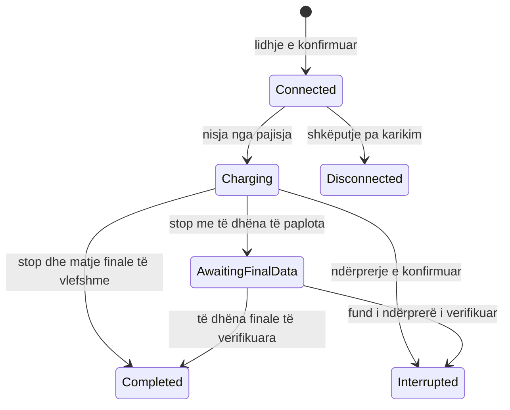

# Modeli i domenit

Ky është modeli i propozuar. Invariantat teknike ruajnë saktësinë; politikat që dokumenti nuk i cakton shënohen për konfirmim.

## Entitetet

| Entiteti | Kuptimi |
|---|---|
| User | Identiteti, një nga tre rolet, gjendja aktive/arkivuar, versioni i sigurisë |
| DriverProfile | Të dhënat personale dhe një grup opsional fushash automjeti |
| DriverSettings | Vetëm preferencat që dakordësohen |
| Location | Vendndodhje me adresë, koordinata dhe arkivim |
| ChargePoint | Njësi logjike që mund të ketë një sesion karikimi aktiv; emër, ID, serial, lidhës, fuqi, koordinata dhe vendndodhje |
| LocationAssignment / PointAssignment | Caktime të administratorit pa role shtesë |
| PriceRevision | Revision i pandryshueshëm i çmimit për kWh, koha e efektit, autori |
| ChargingSession | Lidhja fizike dhe karikimi, drejtuesi kur identifikohet, matje, kohë, snapshot çmimi/kosto |
| SessionMeasurement | Matje të pranuara, burimi dhe cilësia, pa llogaritje të dyfishtë |
| PointStatusChange | Gjendja para/pas, burimi, arsyeja dhe actor kur manual |
| Notification | Ngjarje e kërkuar, marrësi dhe burimi |
| AuditEntry | Veprim administrativ i ruajtur atomikisht me ndryshimin |

**Pikë kundrejt pajisjes:** supozohet që një ChargePoint është një dalje e karikueshme në mënyrë të pavarur. Një kabinet me dy dalje mund të kërkojë dy pika logjike me të njëjtin serial fizik. Nuk vendoset unik seriali globalisht pa njohur pajisjen. Identifikimi provider/device/connector dhe UI-ja për rastin me shumë dalje do të finalizohen me dokumentacionin e karikuesit.

## Gjendja e pikës

Kontrata për klientët përdor pesë vlera të specifikimit. Ngjyra shoqërohet me tekst dhe ikonë; statuset nuk mbështeten vetëm te ngjyra.

| Gjendja | Etiketa | Ngjyra semantike | Disponueshmëria |
|---|---|---|---|
| Available | E disponueshme | E gjelbër | Vetëm me të dhëna të freskëta dhe pa sesion/lidhje aktive |
| Occupied | E zënë / automjeti i lidhur | E verdhë | Jo |
| Charging | Në karikim | Blu | Jo |
| OutOfService | Jashtë funksionit | E kuqe | Jo |
| Maintenance | Në mirëmbajtje | E errët | Jo |

Ruajmë veçmas `reportedState`, `manualRestriction` (None/Maintenance/OutOfService), `lastObservedAt`, `lastReceivedAt` dhe `version`. `effectiveState` llogaritet determinisht: kufizimi manual, nëse ekziston, ka përparësi; ndryshe përdoret gjendja e verifikuar e pajisjes. Matjet dhe gjendja e sesionit ruhen pavarësisht kufizimit manual.

`connectivity` (fresh/stale/unknown) është metadata teknike, jo një rol ose gjendje e gjashtë biznesi. Në mungesë evidencash, statusi i fundit etiketohet si i vjetruar; API nuk deklaron disponueshmëri të konfirmuar. Nuk kthehet stale në Available ose OutOfService pa evidencë. Pika pa asnjë raport ka state null dhe tekst “Gjendje e pakonfirmuar”.

### Tranzicionet

| Evidenca/veprimi | Gjendja e pajisjes | Efekti i aplikacionit |
|---|---|---|
| VehicleConnected mbi pikë të lirë | Available → Occupied | Ruaj connection timestamp; krijo lidhje sesioni, pa energji të shpikur |
| ChargingStarted me lidhje të njohur | Occupied → Charging | Fikso çmimin dhe kohën e nisjes |
| ChargingStarted pa event lidhjeje | Available/Unknown → Charging | Prano evidencën fizike; connectedAt mbetet null; kërko reconciliim metadata |
| ChargingStopped | Charging → Occupied ose Available | Përfundo karikimin; vendos status sipas evidencës së lidhjes |
| VehicleDisconnected | Occupied → Available | Mbyll lidhjen; gjatë karikimit trajto si ndërprerje kur burimi e provon |
| Defekt i verifikuar | Gjendja përkatëse → OutOfService | Mbaj sesionin dhe matjet; mos krijo përfundim të rremë |
| Rikthim i verifikuar nga defekti | OutOfService → gjendja e konfirmuar | Nuk hiqet kufizimi manual |
| Admin vendos Maintenance/OutOfService | reportedState nuk ndryshon | Vendos restriction, audit dhe version të ri |
| Admin heq kufizimin | reportedState nuk ndryshon | Gjendja efektive vjen nga pajisja; Available vetëm nëse konfirmohet |
| Heartbeat/status i përsëritur | Pa tranzicion të ri | Përditëso freshness, pa njoftime/audit manual të dyfishuar |

Admin nuk fabrikon `Occupied` ose `Charging`. Veprimi “E disponueshme” heq kufizimin vetëm kur gjendja fizike e mbështet; përndryshe jep konflikt dhe gjendjen aktuale. Kufizimi gjatë një sesioni aktiv shënon pikën si të padisponueshme për përdorime të reja, por nuk ndalon energjinë fizikisht. Kjo politikë propozohet për të shmangur humbjen e telemetrisë dhe komandat remote jashtë scope-it.

## Cikli i sesionit

Këto janë gjendje teknike të sesionit, të ndara nga pesë gjendjet e pikës. Kur eventi `Start` vjen i pari, sesioni mund të hyjë direkt në Charging me metadata jo të plota. Kur `Stop` vjen para `Start`, eventi ruhet për reconciliim dhe nuk krijon një sesion të dytë me kohë të shpikur.

- `connectedAt`, `startedAt`, `chargingEndedAt`, `disconnectedAt` janë fusha të ndryshme. Kohëzgjatja e karikimit matet nga nisja te fundi, jo nga lidhja te shkëputja.
- Nëse hardware raporton pauza dhe kërkohet koha efektive me energji, kjo duhet saktësuar. Propozimi MVP mat kohën e kaluar nisje–fund; nuk shpiket akumulim pauzash.
- Maksimum një transaksion fizik i hapur për pikë logjike, i mbrojtur nga DB. Fundi fizik dhe plotësia e të dhënave janë të ndara: pas një Stop të verifikuar, sesioni mund të presë matjen finale në `AwaitingFinalData` pa bllokuar regjistrimin e një sesioni të ri fizik. Në mungesë evidence për fundin, nuk lirohet kufizimi me hamendësim; adapteri bën reconciliim. Gjendja e kabllit pas Stop ruhet te pika dhe mund të mbetet Occupied.
- Sesioni pa drejtues të identifikuar mbetet i dukshëm te operatori si i paidentifikuar. Nuk ekspozohet te ndonjë Driver me hamendësim dhe nuk lejohet klienti të vendosë vetë `driverId`.
- Kostot e sesioneve të mbyllura nuk ndryshohen nga matje të vjetra. Matjet e vonuara para finalizimit mund të plotësojnë boshllëqet përmes reconciliimit; korrigjimet pas finalizimit kërkojnë vendim të veçantë, pa fshehur auditin.

## Energjia dhe çmimi

Adapteri normalizon Wh/kWh dhe dallon lexim kumulativ të matësit nga energjia e sesionit. Për matës kumulativ, energjia është diferenca e vlefshme midis leximit fillestar dhe fundit; nuk mblidhen lexime kumulative. Një ulje/restart i matësit nuk trajtohet si energji negative ose kosto zero. Matjet e dyfishuara dhe ato jashtë rendit nuk e ulin totalin e konfirmuar.

Fuqia aktuale është nullable. Kostoja/energjia mund të jenë të papërcaktuara derisa metadata të jetë e vlefshme; UI shfaq mungesën, jo zero. Kosto provizore dhe finale kanë flamur të dallueshëm.

Propozim për pricing, që duhet konfirmuar para implementimit:

1. Fikso çmimin në nisje të karikimit dhe ruaj `priceRevisionId`, `unitPrice`, `currency` dhe versionin e llogaritjes te sesioni.
2. Përdor kohën e fillimit nga pajisja vetëm kur adapteri e verifikon; në mungesë përdor receivedAt dhe ruaj cilësinë e kohës. Eventi i vonuar zgjedh revisionin efektiv për atë kohë; nuk përdor verbërisht çmimin aktual.
3. Backend llogarit `energyKWh × unitPrice` me decimal. Monedha EUR propozohet nga shembulli në Word, por nuk është përfundimisht e konfirmuar.
4. Propozim: energji me gjashtë shifra dhjetore, çmim me gjashtë, kosto finale në dy shifra me midpoint away-from-zero. Pa tarifë kohe, taksa të shtuara ose segmente tarife të shpikura. Propozimi i rrumbullakimit dhe trajtimi tatimor kërkojnë saktësim të biznesit.

Shembull: 20 kWh me 0.35 EUR/kWh = 7.00 EUR. Çmimi i ri 0.40 nuk ndryshon atë sesion. Nëse çmimi dhe Start përpunohen njëkohësisht, lock/version dhe rendi i revisionit sigurojnë një vendim të vetëm të ruajtur.

## Arkivimi

Arkivimi i pikës ruan FK dhe historikun. Propozohet refuzim me konflikt kur ka sesion aktiv ose automjet të lidhur; pasi të jetë liruar, pika nuk shfaqet më në hartën e zbulimit. Eventet e vona historike mund të ruhen/reconciliohen, por nuk e çarkivojnë pikën.

Arkivimi i vendndodhjes propozohet të bllokohet derisa pikat e saj të arkivohen ose zhvendosen shprehimisht. Zhvendosja e pikës me sesion aktiv bllokohet. Të dhënat `locationAtStart`, emri/ID i pikës dhe çmimi i sesionit ruhen që historiku të mos ndryshojë kuptim pas redaktimeve.

Heqja e administratorit arkivon llogarinë, revokon aksesin dhe ruan referencën historike të autorit. Afatet e anonimizimit për privatësi mbeten vendim i veçantë.
