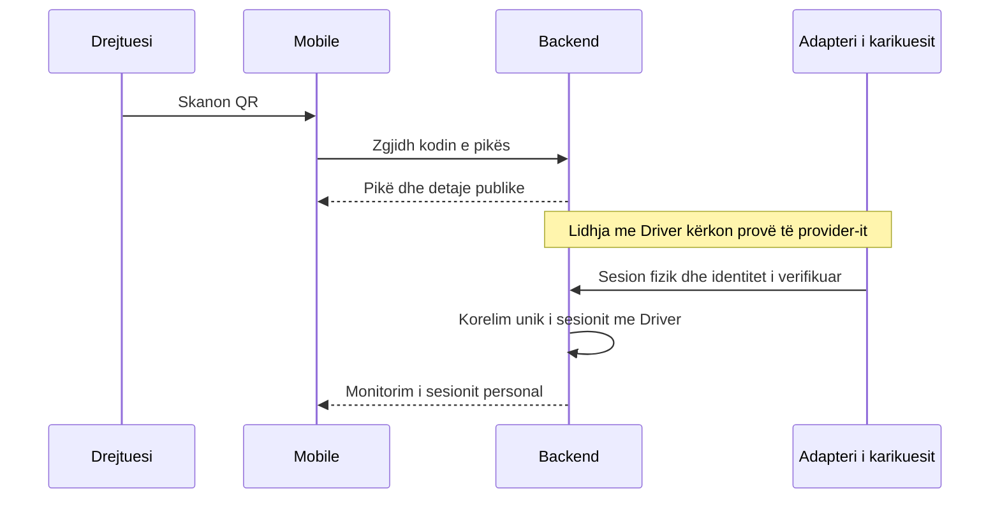

# Integrimi me karikuesit, QR, realtime dhe hartat

Hardware/protokolli real do të dërgohet më vonë nga përdoruesi. Kjo nuk bllokon projektimin ose ndërtimin e domenit me fixtures, por bllokon pretendimin se monitorimi punon me karikues realë.

## Kufiri i adapterit

`IChargerEventAdapter` është kontratë e propozuar që verifikon identitetin e burimit dhe kthen evente të normalizuara. `IChargerEventProcessor` i përpunon përmes rregullave Application/Domain. SDK, OCPP payload, endpoint dhe kredencialet e prodhuesit qëndrojnë në Infrastructure.

Kodi i kolegut konfirmon që prototipi i tij synon OCPP 1.6J mbi WebSocket. U shtua parseri C# për telemetri dhe replay offline; [analiza e burimit](ocpp-reference-review.md) dokumenton kufijtë. Përputhshmëria e pajisjes reale ende nuk është provuar. Versioni i protokollit, push/poll, heartbeat, TLS/auth dhe mënyra e identifikimit të drejtuesit duhen marrë nga pajisja/provider-i. Nuk hapet port publik ose lidhje prodhimi në këtë fazë.

| Fusha e eventit | Qëllimi |
|---|---|
| providerId, eventId | Identitet i qëndrueshëm për deduplikim |
| deviceRef, connectorRef | Mapping serveri te ChargePoint |
| externalSessionId | Korelim i eventeve të të njëjtit sesion |
| kind | Connected, Started, Measurement, Stopped, Disconnected, Faulted, StatusReported |
| observedAt, receivedAt | Koha e pajisjes dhe koha e serverit; audit përdor kohën e serverit |
| sequence dhe bootEpoch, kur ekzistojnë | Dallim retries/renditje/restart i pajisjes |
| cumulativeEnergyKWh ose sessionEnergyKWh | Matje me semantikë të qartë; jo mbledhje e dy vlerave |
| powerKW nullable | Telemetri opsionale |
| driverCorrelation nullable | Provë e verifikuar nga provider-i, jo userId i besuar nga telefoni |
| quality dhe safeReason | Sinjalizim i mungesave, defektit ose mospërputhjes |

Pranohen vetëm lidhje device/connector të provision-uara. Payload-i ka schema, madhësi maksimale dhe kufij kohorë/numerikë; ID të reja ose koordinata të payload-it nuk krijojnë automatikisht pika. Nënshkrimi/autentikimi dhe replay protection përcaktohen sipas provider-it.

### Rendi dhe retry

1. Persisto inbox përpara acknowledgment të pranimit. Ruaj key unik dhe hash të payload-it. I njëjti key/payload është retry; i njëjti key me përmbajtje tjetër është konflikt i integrimit.
2. Serializo përpunimin për pikë/sesion me transaksion dhe constraints. Eventet e vonuara nuk e kthejnë një sesion Completed në Charging.
3. Matjet renditen sipas sekuencës së verifikuar kur ekziston. Timestamp-i vetëm nuk mjafton si çelës deduplikimi. Leximi kumulativ regresiv izolohet për reconciliim.
4. Stop përpara Start dhe metadata që mungon ruhen në gjendje retry/reconciliation, me arsyen. Reconnect mund të kërkojë snapshot nga pajisja nëse protokolli e lejon; nuk shpiket kjo aftësi kur API nuk e ka.
5. Përditësimi i domain, shënimi processed dhe outbox commit-ohen bashkë. Dështimi lë eventin të riprovueshëm, pa sesion ose kosto të dyfishuar.
6. Worker përdor backoff dhe kufi retries; dështimi i qëndrueshëm mbetet i diagnostikueshëm. Eventet nuk zhduken nga sistemi pas retry limit.

Simulatori ushqen të njëjtin kontrakt normalizimi në Development/Test, përfshin duplicate, out-of-order, humbje fuqie, counter reset dhe disconnect. Nuk është integration production dhe nuk importohet në runtime production.

## QR si rrjedhë e propozuar

Përdoruesi sugjeroi që drejtuesi të skanojë QR kur shkon te karikuesi. Kjo rrjedhë shtohet në projektim me status Proposed; formati dhe efekti fizik presin dokumentacionin e hardware.

QR statike mund të kopjohet ose fotografohet. Prandaj ajo mund të identifikojë pikën, por **nuk mjafton për të provuar pronësinë e karikimit**. Skanimi nuk lejon leximin e sesionit të personit që është tashmë duke karikuar. Nuk lidhet automatikisht “sesioni aktiv i kësaj pike” me skanuesin e fundit.

Adapteri duhet të japë një lidhje të verifikueshme mes identitetit të llogarisë dhe transaction/device session. Nëse hardware përdor një challenge njëpërdorimësh, platforma e lidh atë me user/point/expiry dhe e konsumon atomikisht. Kjo është mundësi e kontratës, jo mekanizëm i konfirmuar ose veçori e implementuar. Nëse pajisja jep vetëm telemetri anonime dhe QR statike, monitorimi personal nuk mund të deklarohet i sigurt pa një mekanizëm tjetër të dakordësuar.

Parser-i pranon vetëm formate/hoste të konfiguruara, validon madhësinë dhe vlerat dhe nuk bën fetch të URL-ve arbitrare. Nëse kodi ekzistues i përket platformës së konkurrentit, duhet mapping i autorizuar ose kod i ri; nuk hamendësohet se ai kod mund të përdoret nga aplikacioni ynë. Camera permission kërkohet vetëm gjatë skanimit; harta dhe detajet mbeten të përdorshme kur leja refuzohet.

Nuk shtohen RemoteStart/RemoteStop/rezervim/pagesë nga ky propozim. Nëse prodhuesi kërkon një komandë start për rrjedhën QR, ky është ndryshim scope-i që duhet saktësuar, jo vendim i heshtur i implementimit.

## Realtime

SignalR dërgon evente vetëm pas commit-it: `PointChanged`, `SessionChanged`, `PriceChanged`, `NotificationCreated` dhe invalidim të përmbledhjes kur duhet. Envelope përmban eventId, entityId, entityVersion, occurredAt dhe DTO të kufizuar.

- Hartës i dërgohen vetëm gjendje/disponueshmëri/çmim/koordinata të publikueshme. Asnjë driverId ose telemetri personale në grupin e përgjithshëm.
- Driver merr vetëm sesionet me pronësi të verifikuar. Admin merr evente vetëm për scope aktual; Superadmin globale. Subscribe nuk i beson grupit ose pikës që kërkon klienti.
- Autentikimi bëhet gjatë handshake dhe rivlerësohet për subscribe/dispatch. Revokimi i llogarisë/caktimit pas commit-it heq subscriptions, ndalon dërgimet private dhe mbyll lidhjen kur nevojitet; dispatcher koordinon versionin e aksesit me revokimin. Një socket i hapur nuk ruan leje përgjithmonë.
- Web merr credential jetëshkurtër vetëm për hub-in, pa ekspozuar refresh token. Audience/claims e credential-it nuk lejojnë shkrime REST. URL-të/log-et nuk regjistrojnë bearer token.
- Sinjalet e matjeve mund të bashkohen për UI që të shmanget render i panevojshëm; matjet autoritative ruhen në backend. Fillimi/fundi/defekti nuk humben nga ky bashkim.

Rikthimi: autentiko → subscribe dhe buffer eventet → merr snapshot REST → apliko vetëm eventet me entityVersion më të lartë → ndiq stream. Për ndryshime gjatë snapshot-it përdoret versioni për të shmangur mbishkrimin me gjendje të vjetër. Listat përdorin invalidim dhe refetch të scope-it. EventId bën klientin tolerant ndaj outbox at-least-once; nuk pretendohet exactly-once në rrjet.

Në disconnect klienti tregon “Të dhënat mund të jenë të vjetruara” dhe kohën e fundit. Backoff me jitter, refresh token kur duhet dhe snapshot pas reconnect/resume. REST polling i kufizuar shërben si rikuperim kur hub nuk lidhet. Intervalet/freshness dalin nga heartbeat real dhe matjet e sistemit; nuk premtohet një afat arbitrar si SLA.

## Hartat

Një kontratë e vogël `ChargePointMap` merr `markers`, `viewport`, `selectedPointId` dhe callbacks `onSelect`, `onViewportChange`. Marker ka ID, koordinata, status semantik, disponueshmëri dhe freski. Biznesi nuk importon MapKit, Leaflet ose react-native-maps.

Rekomandimi sipas evidencës lokale HOUSS:

- Web: Leaflet në komponent client-only për pamjen operative dhe zgjedhjen e koordinatave.
- Android: adapter native i izoluar, me sjellje kamere të qëndrueshme.
- iOS: adapter MapKit native, me prova në pajisje përpara release. Modul i ri i pavarur nëse duhet bridge; nuk importohet `houss-apple-map`.

SDK/versioni, tiles/provider dhe çelësat verifikohen në fazën e implementimit. Nuk kopjohet automatikisht endpoint-i i tiles të HOUSS si garanci shërbimi për production.

Koordinatat pastrohen dhe validohen, ID-të janë të qëndrueshme, eventet e telemetrisë ndryshojnë marker-in pa rivendosur zoom/pan. Fokusi ndryshon vetëm nga veprimi i përdoruesit. Kërkesat sipas viewport anulohen kur vjetërsohen. Të gjitha pikat mbeten të zbulueshme përmes viewport/clustering/paginimit; nuk shfaqen vetëm 150 të parat në heshtje.

Kur mungon leja e vendndodhjes, përdoret pamja e rrjetit me pan/zoom. Kur provider-i dështon, përdoruesi sheh gabimin dhe listën e pikave si rikuperim. Fallback nuk zëvendëson kërkesën për hartë funksionale në iOS/Android. Statuset kanë legjendë, tekst dhe etiketa aksesueshmërie; null/stale nuk paraqitet si pikë e lirë.

## Njoftimet

Llojet: jashtë funksionit, defekt, fillim karikimi, përfundim, shkëputje e papritur, ndryshim manual gjendjeje, ndryshim çmimi. Rekomandimi minimal është listë in-app me përditësime SignalR për Admin/Superadmin. Për Driver propozohen vetëm eventet e sesionit të vet, nëse kjo konfirmohet. Përdoruesi konfirmoi push në telefon dhe gjuhët sq/en sipas zgjedhjes. Transporti Expo, radhët dhe tekstet janë implementuar në backend; lidhja me eventet reale dhe prova në pajisje mbeten për më vonë. Email/SMS nuk janë shtuar.

Njoftimi i qëndrueshëm krijohet/deduplikohet sipas eventId/recipient/type, delivery pas commit-it. Marrësit rivlerësohen sipas aksesit; nuk dërgohen të dhëna të pikës te ish-admini pas revokimit. Alarmet teknike të inbox/outbox janë log/monitorim i operimit dhe nuk shtojnë kategori produkti. Humbja e heartbeat nuk emërtohet “automjeti u shkëput papritur” pa evidencë nga pajisja.
