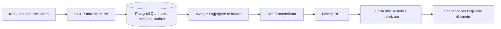

# Kontrolli i projektit dhe testimit — 4 tetor 2026

Baza: commit `56c85c0` dhe ndryshimet lokale të këtij kontrolli. Verifikimi është lokal; nuk konfirmon një deploy të ri në Render.

**Ka ende punë përpara daljes në treg. Testet nuk mbulojnë të gjithë kodin dhe disa funksione të kërkuara nga klienti mungojnë.** Rrjedha web e drejtuesit me OCPP 1.6 dhe simulatorë është pjesa më e zhvilluar. [Krahasimi me dokumentin e klientit](client-requirements-audit.md) përmban matricën e kërkesave; ky raport përditëson arkitekturën, regjistrimin dhe provat.

## Çfarë u përfundua në këtë hap

### Krijimi i llogarisë së drejtuesit

- Faqja `/register`, e arritshme nga **Nuk ke llogari? Regjistrohu** në faqen e hyrjes.
- Emër, mbiemër, email, numër celulari, fjalëkalim dhe konfirmim fjalëkalimi; formulari dhe gabimet në shqip/anglisht.
- Serveri kërkon të katër fushat e kontaktit, validon emrat/email-in, normalizon numrin me kodin e shtetit dhe kërkon fjalëkalim me 12–128 karaktere. Numrat me `00` në fillim normalizohen në `+`; hapësirat, kllapat dhe vizat hiqen. Shembull: `00355 69 1234567` → `+355691234567`.
- Numri ruhet në fushën ekzistuese `Account.Phone`, kështu që nuk nevojitet migrim i ri. Llogaritë ekzistuese pa numër mbeten të vlefshme. Klientët që thërrasin regjistrimin duhet tani të dërgojnë `phone`; formulari mobile u përditësua për këtë kontratë.
- Regjistrimi krijon gjithmonë `DRIVER`, me historik personal bosh. Fushat e rolit/pronësisë nga klienti refuzohen. Pas suksesit përdoruesi hyn automatikisht te `/driver`.
- Web-i mban token-in vetëm në cookie HttpOnly/SameSite strict, me Secure në production. Përgjigjja JSON për shfletuesin përmban vetëm përdoruesin. Hyrja dhe regjistrimi ndajnë të njëjtën politikë cookie-je.
- Dërgimi i dyfishtë bllokohet në formularin web. Email-i i përdorur, celulari i pavlefshëm dhe kufizimi i përpjekjeve japin mesazh dhe lejojnë korrigjimin.

Validimi i formatit të celularit nuk provon pronësinë e tij. Nuk është shtuar SMS, verifikim email-i ose rikuperim fjalëkalimi në këtë hap.

### Qëndrueshmëria e karikimit dhe ngjarjeve live

1. **Ngjarje e dëmtuar në outbox:** nuk bllokon më ngjarjet pas saj. Rreshti ruhet me `invalid_event`, numër përpjekjesh dhe pritje pesë minuta për diagnostikim. Një event publik që përmban sesion ose komandë private refuzohet. Kjo nuk e heq nevojën për monitorim dhe politikë pastrimi të radhës.
2. **Arkivim gjatë përdorimit:** kontrollohen sesionet fizike aktive dhe lidhjet `Waiting`/`Linked`, përveç statusit publik. `Maintenance`, `Unknown` ose `OutOfService` nuk provojnë që pika është e lirë.
3. **Konkurencë gjatë arkivimit:** arkivimi merr lock-un e pajisjeve në rend të qëndrueshëm dhe pastaj të pikës. Nisja fizike refuzon pikën e arkivuar. Lidhja e drejtuesit rikontrollon provën pas lock-ut, sepse arkivimi mund të jetë kryer gjatë pritjes. Janë shtuar prova PostgreSQL për këto dy gara; ekzekutimi i tyre mbetet i pakryer lokalisht.
4. **Simulator i arkivuar:** inicializimi pas restart-it e ruan arkivimin, pa rikrijuar pikën ose rrëzuar nisjen e API-së.
5. **Kërkesë web e anuluar:** backend forwarding ruan sinjalin e klientit bashkë me timeout-in. Hyrja, regjistrimi, veprimet e profilit dhe lidhja me pikën e përcjellin anulimin.

## Arkitektura

Ruhet monoliti modular .NET, PostgreSQL dhe BFF Next.js. Në këtë fazë nuk ka arsye të ndahet në mikroshërbime. Varësitë Domain → pa infrastrukturë dhe Application → Domain kontrollohen tani me teste; kontratat publike nuk mund të ekspozojnë tipe EF ose Infrastructure.

Rrjedha aktuale është:



SSE transmeton përditësimet; inbox dhe lock-u i pajisjes mbrojnë përpunimin, ndërsa outbox publikohet pas commit-it. Dërgimi është me mundësi përsëritjeje; klienti përdor identitetin/versionin e ngjarjes. Snapshot-i rikthen gjendjen pas shkëputjes. Përfundimi i një animacioni, humbja e WebSocket-it dhe heqja fizike e kabllit janë ngjarje të ndryshme.

**Shpërndarja aktuale supozon një instancë backend.** Bus-i dhe regjistri WebSocket janë në memorien e procesit. Për disa instanca duhen pronësi e koordinuar e lidhjeve, lease për worker-at dhe shpërndarje e ngjarjeve mes instancave. Nuk mjafton vetëm të shtohet një instancë në Render. Edhe reconcile gjatë deploy-it me mbivendosje instancash duhet provuar në atë model.

Përmirësimet strukturore me vlerë në vijim:

- Shto modulet Access/Locations/Pricing për kërkesat konkrete administrative, duke ruajtur rregullat dhe transaksionet në vendin ku zbatohet veprimi.
- Përditëso kontratat TS nga një burim API-je kur shtohen modulet; sot `contracts/account.ts` mbahet me dorë.
- Shto paginim për historikun dhe listat administrative. Historiku personal aktualisht kufizohet në 100 sesione.
- Shto politikë retention për inbox, matjet e papërpunuara dhe outbox, me afate sipas nevojës së diagnostikimit dhe privatësisë.
- Mat vonesën receive → commit → SSE → UI dhe moshën e ngjarjes më të vjetër në radhë. Përqindja e coverage nuk provon vonesën live nën ngarkesë.

## Testet dhe mbulimi i matur

### Backend

**161 teste kaluan; 12 prova PostgreSQL u anashkaluan.** Testet që kaluan përfshijnë HTTP/autorizimin, WebSocket OCPP në TestServer, SSE, privatësinë, nisje/matje/përfundim, rikuperim outbox, regjistrim, arkivim dhe push.

Adapteri real `ExpoPushTransport` është provuar me `HttpMessageHandler` lokal: payload, autorizim, ticket, receipt, kufizim kërkesash, gabime të përkohshme dhe token pajisjeje i pavlefshëm. Këto prova nuk kontaktojnë Expo dhe nuk vërtetojnë dorëzim në telefon.

Mbulimi Microsoft Code Coverage/Cobertura për katër assembly-t e aplikacionit:

| Assembly | Rreshta | Degë kushtesh |
|---|---:|---:|
| API | 88.10% | 76.52% |
| Application | 59.54% | 77.17% |
| Domain | 90.13% | 85.53% |
| Infrastructure | 91.27% | 78.73% |
| Gjithsej | **87.41%** | **78.95%** |

Migrimet e gjeneruara dhe `obj` përjashtohen nga kjo matje. Startup, demo, mapping-et dhe kodi i shkruar me dorë mbeten brenda. Application përmban edhe kode të gjeneruara nga record-et/kontratat; kjo përqindje nuk është vetëm mbulim i rregullave të biznesit.

Rruga relazionale e lock-eve, izolimi, kufizimet SQL dhe migrimet nuk provohen nga EF InMemory. Dymbëdhjetë testet PostgreSQL përdorin databazë të posaçme `evcharging_test*`, schema të veçanta dhe migrimet reale. Një test i anashkaluar nuk është rezultat pozitiv.

TestServer është integrim i pjesëve të aplikacionit në proces. Nuk provon reverse proxy-n e Render, rrjetin real, TLS-in e pajisjes ose një karikues fizik.

### Web

**114 teste kaluan**, bashkë me TypeScript dhe build-in production Next.js.

Mbulimi i kodit production që u ngarkua nga testet: **89.28% rreshta / 78.67% degë**, në **28 nga 62 skedarë TS/TSX**. Skedarët e tjerë nuk kanë përqindje të matur. Kjo nuk është “89% e gjithë web-it”. Raporti liston veçmas 34 skedarët jashtë matjes, përfshirë hartën, panelin e simulatorit, formularin e profilit dhe disa faqe/BFF.

Testet e reja ekzekutojnë handler-at realë BFF dhe komponentin e formularit me varësi të kontrolluara: cookie HttpOnly, CSRF, rol i palejuar, gabimet e regjistrimit, lexim pa lidhje automatike, connect/cancel, anulim kërkesash dhe kalim i chunk-ut të parë SSE ndërsa stream-i është ende i hapur. Testet e formularit provojnë tekstet/etiketat, payload-in, konfirmimin e fjalëkalimit dhe navigimin pas suksesit.

Ngarkuesi i përbashkët kompilon burimin TS/TSX me source maps, kështu që coverage lidhet me skedarin origjinal. Mjetet e testit nuk futen në përqindjen production. Ai përdor `Module._compile` vetëm në teste; ndryshimi i versionit Node kërkon rikontroll të këtij ngarkuesi.

Këto janë prova të handler-ave dhe komponentëve në proces; nuk provojnë DOM-in real, klikimet në hartë, fokusin, layout-in mobile ose rrjedhën shfletues → Next → ASP.NET → PostgreSQL. Faqja `/register` u gjenerua me sukses nga build-i, por nuk u testua me klikime në shfletues në këtë hap.

### Verifikime të tjera

- OCPP replay kaloi: 20 kWh, kosto 7 EUR, një event i dyfishuar i injoruar.
- Kaluan 13 raste për startup-in Render me dotnet të simuluar, pa databazë/rrjet.
- C# u formatua me CSharpier; kontrolli i diff-it kaloi.
- Sintaksa e 9 skedarëve në `mobile/src` u kontrollua pa gabime. Build/typecheck i plotë mobile dhe provat Android/iOS nuk u ekzekutuan: dependencies Expo nuk janë instaluar këtu.
- Workflow i ri GitHub Actions përgatit PostgreSQL 16 të përkohshëm, ekzekuton testet dhe ruan raportet. Workflow nuk është ekzekutuar nga ky ambient; duhet parë rezultati pas push-it.

## Çfarë mbetet dhe është në dorën tonë

| Prioritet | Punë | Kriter për përfundim |
|---|---|---|
| 1 | Caktimet e pikave/vendndodhjeve për Admin dhe menaxhimi i administratorëve | API kufizon çdo listë/veprim sipas caktimit; teste negative provojnë që ndryshimi i ID-së nuk kalon autorizimin. Superadmin krijon, ndryshon dhe çaktivizon llogaritë. |
| 1 | Monitori administrativ dhe dashboard live | Sesione aktive/përfunduara, statuset dhe energjia, filtra dhe paginim; të dhënat kufizohen sipas rolit dhe përditësohen pas eventeve. |
| 1 | Historiku i çmimeve dhe audit para/pas | Çdo ndryshim ka actor, arsye, vlera dhe kohë. Tarifa e sesionit ekzistues ruhet. |
| 1 | Prova PostgreSQL dhe shfletues me dy drejtues | Regjistrim/hyrje, lidhje, karikim, pause/error/resume, unplug, restart dhe izolim në hartë e detaj kalojnë mbi storage reale. |
| 2 | Njoftimet operative të mbetura | Lidh ngjarjet Started/Fault/ManualStatus/Price me marrësit e autorizuar. Completion dhe UnexpectedDisconnect kanë tashmë thirrës operativë. |
| 2 | Vendndodhjet e menaxhuara dhe seriali në menaxhim | Burime të veçanta, arkivim i kontrolluar dhe lidhje e pikës me vendndodhjen/pajisjen. |
| 2 | Rikuperimi i llogarisë | Rrjedhë reset me token njëpërdorimësh, skadim dhe revokim sesionesh; dërgimi email kërkon shërbim të konfiguruar. |
| 2 | Vëzhgimi, retention dhe prova ngarkese | Vonesa live e matur, backlog/retry i dukshëm, gabime me correlation ID, pastrim i kontrolluar dhe test me dhjetë pika njëkohësisht. |

Qëllimi i testeve të tjera duhet të jetë mbulimi i këtyre sjelljeve dhe dështimeve, jo vetëm rritja e përqindjes me prova që përsërisin implementimin.

## Çfarë kërkon mjedis ose pajisje të jashtme

- Karikues fizik, konfigurim i matjeve të mbështetura dhe mënyrë e verifikuar për lidhjen e drejtuesit me transaksionin. SoC dhe koha deri në bateri të plotë nuk garantohen nga çdo karikues; mungesa e tyre nuk plotësohet me vlera të shpikura.
- Credentials/konfigurim Expo dhe pajisje për të provuar ticket → receipt → njoftim real në gjuhën e përdoruesit.
- Konfigurim email-i për rikuperimin/verifikimin e llogarisë, nëse kjo rrjedhë përfshihet në publikim.
- Staging me databazë të posaçme për backup/restore, migrim/rollback, restart gjatë karikimit dhe humbje rrjeti.
- Kontroll aktual i advisories/dependencies përpara publikimit. Nuk u krye kontroll online ose instalim pakete në këtë hap.

OCPP 2.0.1 mbetet adapter i ardhshëm; lidhjet e dokumentacionit nuk e bëjnë të implementuar. Mbështetja aktuale reale e këtij kodi është rrjedha e dokumentuar OCPP 1.6.

## Riprodhimi i kontrolleve

Paketat duhet të jenë të restauruara paraprakisht. Komandat lokale më poshtë nuk instalojnë dependencies:

```powershell
./scripts/test-backend-coverage.ps1
cd web
npm run test:coverage
npm run typecheck
npm run build
```

Raportet janë në `.local/coverage/backend/<run-id>/` dhe `.local/coverage/web/`; mbahen jashtë Git-it. Web-i ruan `tests.txt`, `lcov.info`, `summary.json` dhe `summary.md`, përfshirë inventarin jashtë matjes. Backend-i ruan TRX, Cobertura dhe përmbledhjen sipas assembly-t.

Për PostgreSQL vendos `EVCHARGING_TEST_POSTGRES_ENABLED=1` dhe `EVCHARGING_TEST_POSTGRES` vetëm për një databazë të posaçme të hedhshme me emër `evcharging_test*`. Testet refuzojnë emra të tjerë dhe krijojnë/heqin vetëm schema testimi brenda saj. Në CI këto të dhëna janë të përkohshme dhe të deklaruara në workflow.

Nuk u krye commit, push ose deploy nga ky kontroll.
